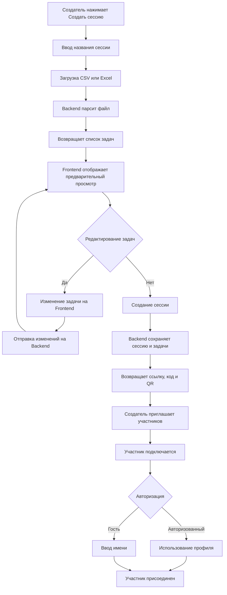

# Блок-схема процесса



---

# Импорт задач

| Столбец | Обязательный | Назначение |
| :--- | :--- | :--- |
| ID задачи | Да | Идентификатор задачи во внешней системе |
| Проект | Нет | Название проекта |
| Теги | Нет | Теги задачи |
| Заголовок | Да | Название задачи |
| Заявитель | Нет | Автор задачи |
| Создана | Нет | Дата создания |
| Обновлена | Нет | Дата обновления |
| Завершенная | Нет | Признак завершения |
| Приоритет | Нет | Приоритет задачи |
| Тип | Нет | Тип задачи |
| Состояние | Нет | Статус задачи |
| Исполнитель | Нет | Исполнитель |
| Original estimation | Нет | Исходная оценка |
| Story points | Нет | Существующая оценка |
| Sprints | Нет | Спринты |
| Ideal days | Нет | Оценка в идеальных днях |
| Описание | Нет | Полное описание задачи |
| Голоса | Нет | Количество голосов |

Парсинг CSV при помощи csvhelper, Excel - ClosedXML.

## Обработка тегов
`backend, api, bug` -> `["backend", "api", "bug"]`

## Обработка приоритетов
Допустимые приоритеты:

| Значение | Enum |
| :--- | :--- |
| Обычная | Normal |
| Неотложная | Urgent |
| Критическая | Critical |
| Серьезная | Major |
| Незначительная | Minor |

---

# Предварительный просмотр задач

Backend должен:
* Получить файл
* Проверить формат и структуру
* Распарсить задачи
* Сохранить результат импорта во **временном хранилище** 
* Вернуть задачи на frontend

## Редактирование задач перед созданием
На этапе предварительного просмотра frontend позволяет редактировать:
* заголовок
* описание
* приоритет
* теги

Изменения не сохраняются в основной базе данных до создания сессии.
При создании сессии backend должен использовать значения, переданные frontend, а не первоначальные значения импорта

---

# Создание сессии

При создании сессии backend должен:
1. Проверить что пользователь, cоздающий сессию, авторизован
2. Проверить название сессии
3. Проверить список задач
4. Проверить значения приоритетов
5. Создать сессию
6. Создать задачи сессии
7. Сгенерировать код приглашения
8. Сгенерировать ссылку приглашения
9. Сформировать QR-код
10. Сохранить данные в базе
11. Скопировать ссылку приглашения пользователю
12. Вернуть результат frontend

## Целостность данных

Создание сессии и всех её задач должно происходить в рамках одной транзакции: если при сохранении какой-то задачи произойдет сбой, вся сессия и предыдущие задачи должны откатиться, чтобы в базе не оказалось поломанных данных

## Генерация ссылки, кода и QR-кода. Например, H6R9CKPX
### Требования:
* 8 символов
* латинские буквы и цифры
* буквы заглавные
* никаких доп символов *, /, _, % и тп
* исключить неоднозначные символы: O, 0, I, 1
* код должен быть уникальным
* **не использовать библиотеку random**
* при коллизии - перегенеривать код

### Формат ссылки
`http://<frontend-domain>/join/<joinCode>`

### Содержание QR-кода
QR-код должен содержать ссылку приглашения. (**не хранить его в бд**)

---

# Создание пользователем сессии

Создавать сессию может только авторизованный пользователь

# Присоединение пользователя к сессии

Пользователь может подключиться к сессии тремя способами:
* по ссылке
* по коду
* по QR-коду.

Все способы должны приводить к одному процессу подключения

## Присоединение гостя
**Request**
```json
{
  "name": "Петя",
  "role": "Guest"
}
```
Для гостя backend должен создать участника и выдать jwt-token

---

# Валидация

### Название сессии
* Не может быть пустым
* Должно содержать от 1 до 255 символов
* Удаление лишних пробелов (Trim) 
* Запретить использование угловых скобок (< и >) - для безопасности

### Имя гостя
* Не может быть пустым
* Должно содержать от 1 до 20 символов

### Задачи
* Количество задач должно быть не менее 1
* Максимальное количество задач - 500
* Заголовок обязателен
* Заголовок не может превышать 255 символов
* Приоритет должен соответствовать допустимому enum

### Доступ
* Гость может подключаться только к существующей сессии

### Файлы
* Проверять формат и размер
* Не выполнять содержимое файла
* Не сохранять оригинальный файл без необходимости
* Не использовать имя файла для формирования пути на сервере
* Максимальное количество загружаемых задач - 500, для безопасности

---

# Какие ошибки кидать

## Парсинг Excel

| Сценарий | Ожидаемый результат |
| :--- | :--- |
| Корректный CSV | Успешный импорт |
| Корректный Excel | Успешный импорт |
| Пустой файл | Ошибка |
| Отсутствует заголовок | Ошибка |
| Отсутствует ID задачи | Ошибка строки |
| Отсутствует заголовок задачи | Ошибка строки |
| Неизвестный приоритет | Предупреждение |
| Некорректная дата | Предупреждение |
| Повторяющиеся теги | Дубликаты удалены |
| Превышен размер файла | Ошибка |

{
  "type": "https://api.example.com/errors/invalid-file",
  "title": "Ошибка валидации файла",
  "status": 400,
  "detail": "Отсутствует обязательный столбец 'ID задачи'.",
  "instance": "/api/sessions/import"
}

## Присоединение участника

| Сценарий | Ожидаемый результат |
| :--- | :--- |
| Корректный код | Сессия найдена |
| Несуществующий код | 404 |
| Корректное имя гостя | Участник создан |
| Пустое имя | 400 |

---

# Backend готов, если:

- [ ] Backend принимает CSV и Excel.
- [ ] Backend корректно распознаёт столбцы задач.
- [ ] Backend возвращает распарсенные задачи frontend.
- [ ] Frontend может редактировать задачи перед созданием сессии.
- [ ] Backend создаёт сессию с изменёнными задачами.
- [ ] Задачи сохраняются с правильным порядком.
- [ ] Сессия сохраняется в PostgreSQL.
- [ ] Backend генерирует уникальный код приглашения.
- [ ] Backend возвращает ссылку на сессию.
- [ ] Backend генерирует QR-код с корректной ссылкой.
- [ ] Участник может подключиться по коду.
- [ ] Гость может присоединиться с указанием имени.
- [ ] Backend возвращает ошибки в едином формате.
- [ ] Основные сценарии покрыты тестами.
- [ ] Swagger содержит описание всех реализованных эндпоинтов для фронтера.